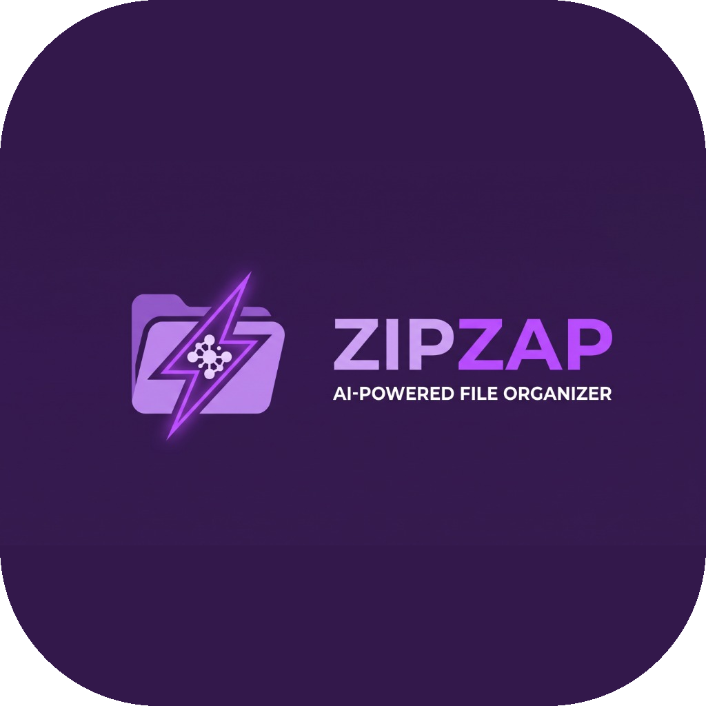

<div align="center">
  
  
  # ⚡ ZipZap: AI-Powered File Organizer
  
  **ระบบจัดการไฟล์อัจฉริยะที่ขับเคลื่อนด้วยพลัง AI (Google Gemini)** 
  
  [](https://github.com/poko56/SDDi-2026/actions/workflows/build.yml)
</div>

---

## 👥 รายชื่อทีม (Team)

- **A (Backend):** poko56
- **B (Frontend 1):** นายสรวิชญ์ สิทธิรักษ์ 68030288
- **C (Frontend 2):** ศรัณย์ สังขบุญ 68030273
- **D (Tester):** นายวีระภัทร อ่วมเกษม (weerapat uamkasem)

---

## 🌟 ฟีเจอร์หลัก (Features)

ZipZap ไม่ได้เป็นแค่โปรแกรมจัดการไฟล์ธรรมดา แต่มันสามารถ "เข้าใจ" ไฟล์ของคุณได้ผ่าน AI:

*   🤖 **AI Smart Rename (ตั้งชื่อไฟล์อัจฉริยะ):** ให้ Gemini วิเคราะห์เนื้อหาในรูปภาพ (JPG, PNG, HEIC, WEBP) หรือเอกสาร (PDF, TXT) แล้วตั้งชื่อไฟล์ใหม่ให้สื่อความหมาย เช่น `IMG_0001.png` → `20260314_Starbucks_Receipt.png`
*   💬 **Chat with Your Files (คุยกับไฟล์ของคุณ):** ถามคำถามเกี่ยวกับไฟล์ในโฟลเดอร์ เช่น "มีไฟล์เอกสารอะไรบ้าง" AI จะตอบพร้อมปุ่ม **เปิดไฟล์** ให้กดได้ทันที
*   📂 **Auto Organize (จัดหมวดหมู่ไฟล์):** จัดไฟล์เข้าโฟลเดอร์ตาม **ประเภท** (Images, Documents, Videos ฯลฯ) หรือตาม **เดือนที่แก้ไข** ในคลิกเดียวจากหน้า Dashboard
*   🗑️ **Smart Cleaner (ล้างไฟล์ขยะ):** หาไฟล์ซ้ำ (SHA-256), ไฟล์ชั่วคราว และไฟล์ใหญ่ที่ไม่ได้ใช้ เลือกได้ทีละไฟล์ ไฟล์ที่เลือกจะถูก **ย้ายไป `.zipzap_trash`** ไม่ได้ลบทิ้งถาวร
*   ↩️ **Undo:** ทุกการย้าย/เปลี่ยนชื่อ (Cleaner, Organize, Smart Rename) ถูกบันทึกไว้ กดปุ่ม **ย้อนกลับ** ที่ Dashboard เพื่อคืนไฟล์ทีละไฟล์
*   👁️ **Auto Monitor (เฝ้าดูโฟลเดอร์):** ไฟล์ใหม่ที่วางในโฟลเดอร์เป้าหมายจะถูกจัดเข้าหมวดทันที และไฟล์ `.docx` ที่วางใน `Convert_to_PDF/` จะถูกแปลงเป็น PDF อัตโนมัติ
*   🚫 **โฟลเดอร์ยกเว้น:** ตั้งค่าโฟลเดอร์ที่ไม่ต้องการให้ ZipZap แตะได้ในหน้า Settings

### 🛠️ เครื่องมือเสริม (Universal Converter)
*   **แปลง/บีบอัดรูปภาพ:** แปลงเป็น JPG/PNG หรือบีบอัดรูปที่ใหญ่เกิน 5MB (รองรับ HEIC, WEBP)
*   **แปลงไฟล์ Word เป็น PDF:** แปลงไฟล์ `.docx` เป็น `.pdf` (ต้องมี Microsoft Word ในเครื่อง)
*   **แยกเสียงจากวิดีโอ:** ดึงเสียงจาก MP4, MOV, MKV, AVI ออกมาเป็นไฟล์ MP3

---

## 🚀 การติดตั้งและใช้งาน (Installation)

### 📦 ดาวน์โหลดแอปสำเร็จรูป (พร้อมใช้งาน)
ดาวน์โหลดได้จากหน้า **[Releases](https://github.com/poko56/SDDi-2026/releases)**:
*   **`latest`** — บิ้วล่าสุดจาก branch `main` (อัปเดตอัตโนมัติทุกครั้งที่มีการ push)
*   **`vX.Y.Z`** — เวอร์ชันที่ออกอย่างเป็นทางการ

มีให้ทั้ง **Windows** (`ZipZap-Windows.exe`) และ **macOS** (`ZipZap-Mac-App.zip`)

> **Note:** สำหรับ macOS หากเปิดแอปแล้วขึ้นเตือนความปลอดภัย (Gatekeeper) ให้ทำการ **คลิกขวาที่แอป -> เลือก Open** เพื่ออนุญาตการใช้งานในครั้งแรก

### 🔑 ใส่ Gemini API Key (ทำครั้งเดียว)
ฟีเจอร์ AI (Chat และ Smart Rename) ต้องใช้ **Gemini API Key ของคุณเอง** — ตัวแอปที่ดาวน์โหลดไป **ไม่มี key ฝังอยู่**
1. สร้าง key ฟรีที่ **[Google AI Studio](https://aistudio.google.com/apikey)**
2. เปิด ZipZap → เมนู **Settings** → วาง key ในช่อง **Gemini API Key** → กด **บันทึก**
3. ถ้าขึ้น ✅ "เชื่อมต่อ Gemini แล้ว" ก็พร้อมใช้งาน

Key ถูกเก็บไว้ในเครื่องของคุณเท่านั้นที่ `~/.zipzap/config.json` (สิทธิ์ไฟล์ `600` อ่านได้เฉพาะเจ้าของ) กด **ลบ key** ในหน้า Settings เพื่อลบออกได้ทุกเมื่อ

ZipZap หา key ตามลำดับนี้:
1. key ที่บันทึกในหน้า Settings
2. Environment variable `GEMINI_API_KEY`
3. ไฟล์ `api_key.txt` ในโฟลเดอร์โปรเจกต์ (เฉพาะตอนรันจาก source เพื่อความสะดวกของนักพัฒนา — ไฟล์นี้อยู่ใน `.gitignore` และไม่ถูกใส่ในตัวแอปที่บิ้ว)

### 💻 รันจาก Source Code (สำหรับนักพัฒนา)

1. **Clone Repository:**
   ```bash
   git clone https://github.com/poko56/SDDi-2026.git
   cd SDDi-2026
   ```

2. **ติดตั้ง Dependencies** (Python 3.10+):
   ```bash
   pip install -r requirements.txt
   ```

3. **รันแอป:**
   ```bash
   python main.py
   ```

ไฟล์ตั้งค่าและประวัติการทำงาน (`config.json`, `action_log.txt`, `action_log.json`) จะถูกเก็บไว้ที่ `~/.zipzap/`

---

## 🏗️ โครงสร้างโปรเจกต์ (Project Structure)

```
main.py                 จุดเริ่มโปรแกรม: สร้าง services แล้วเปิดหน้าต่าง
core/                   Business logic ทั้งหมด (ไม่ import UI จึงทดสอบได้โดยไม่ต้องเปิดหน้าต่าง)
  services.py           Composition root: สร้างทุก service ครั้งเดียวและส่ง dependency ให้กัน
  llm.py                GeminiClient — ห่อ Google GenAI SDK ไว้ที่เดียว
  ai_assistant.py       ตอบคำถามเกี่ยวกับไฟล์ในโฟลเดอร์
  organizer.py          จัดไฟล์ (Strategy: ByFileType, ByModifiedMonth) และ Smart Rename
  cleaner.py            สแกนไฟล์ซ้ำ/ขยะ/ไฟล์ใหญ่ และย้ายไปถังขยะ
  converter.py          แปลงรูป เอกสาร และสื่อ (registry ของรูปแบบการแปลง)
  watcher.py            Auto Monitor ด้วย Watchdog
  stats.py              คำนวณพื้นที่ที่ใช้แยกตามหมวด
  logger.py             บันทึกกิจกรรมและประวัติการย้ายไฟล์สำหรับ Undo
  config.py             โหลด/บันทึกการตั้งค่า และหา API key
  exclusion.py          โฟลเดอร์ยกเว้น (ใช้ร่วมกันทุก service)
  file_types.py         ตารางนามสกุล → หมวดหมู่ และ format_size
  paths.py              ตำแหน่ง resource / user data และ safe_join
ui/
  app.py                หน้าต่างหลัก: เมนูนำทาง, state ที่ใช้ร่วมกัน, สะพานระหว่าง worker thread กับ Tk
  theme.py, widgets.py  สี ฟอนต์ ไอคอน และ widget ที่ใช้ซ้ำ
  pages/                หนึ่งหน้า = หนึ่งคลาส (Dashboard, Cleaner, Converter, AI Chat, Monitor, Settings)
tests/                  Unit tests ของ core/ (pytest)
scripts/                สคริปต์ช่วยพัฒนา (สร้างไอคอน, สร้างไฟล์ทดสอบ)
```

### หลักการออกแบบ (Design Decisions)
*   **แยก Layer:** `ui/` เรียกใช้ `core/` ได้ แต่ `core/` ไม่รู้จัก `ui/` เลย — logic ทั้งหมดจึงทดสอบได้ใน CI บน Linux ที่ไม่มีหน้าจอ
*   **Dependency Injection:** `core/services.py` เป็นที่เดียวที่สร้าง object และส่ง dependency เข้าไปทาง constructor เช่น `FileOrganizer(logger, llm, exclusion)` ทำให้ใน test ส่ง `FakeLLM` เข้าไปแทน Gemini จริงได้
*   **Open/Closed:** เพิ่มวิธีจัดไฟล์ใหม่ได้ด้วยการเพิ่ม subclass ของ `SortStrategy` และเพิ่มรูปแบบการแปลงไฟล์ด้วยการเพิ่ม entry ใน registry ของ `FileConverter` โดยไม่ต้องแก้ UI
*   **Observer:** หน้าต่าง ๆ ไม่เรียกกันตรง ๆ แต่ subscribe การเปลี่ยนโฟลเดอร์และ log ผ่าน `ZipZapApp`
*   **Thread-safety:** งานหนักรันใน worker thread ผ่าน `app.run_background()` และส่งผลกลับเข้า UI ผ่านคิวที่ main thread อ่านทุก 50ms

---

## 🧪 การทดสอบ (Testing)

```bash
pip install -r requirements-dev.txt
pytest -v
flake8 main.py core/ ui/ scripts/ tests/
```

Test ทั้งหมดไม่เรียก Gemini จริง (ใช้ `FakeLLM`) จึงรันได้โดยไม่ต้องมี API key

---

## 🔄 CI/CD (GitHub Actions)

Workflow [`build.yml`](.github/workflows/build.yml) มี 5 jobs:

| Job | ทำงานเมื่อ | หน้าที่ |
|---|---|---|
| `lint` | ทุก push และ PR | ตรวจ PEP 8 และ pyflakes ด้วย flake8 (ไม่ผ่าน = CI fail) |
| `test` | ทุก push และ PR | รัน pytest และอัปโหลดผล `test-results.xml` |
| `build-windows` / `build-mac` | push เท่านั้น หลัง lint + test ผ่าน | บิ้วแอปด้วย PyInstaller |
| `release` | push ไป `main` | Deploy ขึ้น pre-release **`latest`** ใหม่ทุกครั้ง |
| | push tag `v*` | สร้าง Release ตามเวอร์ชันพร้อม release notes อัตโนมัติ |

ออกเวอร์ชันใหม่:
```bash
git tag v1.1.0
git push origin v1.1.0
```

---

## 🛠️ เทคโนโลยีที่ใช้ (Tech Stack)
*   **Python 3:** ภาษาหลักในการพัฒนา
*   **CustomTkinter:** ออกแบบหน้าตา UI ที่ดูทันสมัยและรองรับ Dark Mode
*   **Google GenAI SDK:** เชื่อมต่อกับ Gemini (`gemini-flash-lite-latest` สำหรับแชท, `gemini-3.6-flash` สำหรับ Smart Rename)
*   **Watchdog:** ระบบ Auto Monitor แบบ event-driven (ไม่ต้อง polling)
*   **Pillow / pillow-heif / moviepy / docx2pdf:** แปลงรูป สื่อ และเอกสาร
*   **pytest / flake8:** Unit tests และตรวจคุณภาพโค้ด
*   **PyInstaller + GitHub Actions:** บิ้วแอป Windows และ Mac และ deploy ขึ้น GitHub Releases อัตโนมัติ

---
*Developed with ❤️*
